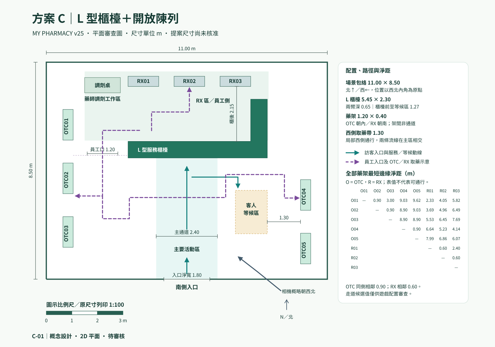

# 方案 C｜L 型櫃檯與開放陳列

[檢視 SVG](layout-proposal-c-2d.svg) · [檢視 PNG](layout-proposal-c-2d.png)

這是送審的候選平面。SVG 以 64 圖面單位表示 1 m，原尺寸列印為 1:100。縮放畫面時可用圖示比例尺。座標以西北內角為原點，x 向東、y 向南。圖上設備的邊緣座標與模型的中心座標須分開解讀。

## 尺寸來源

| 項目 | 原模型 | 本方案候選 |
|---|---|---|
| 室內邊界 | 地板 9 × 7 m | **11.00 × 8.50 m**，南側面寬 11 m |
| 南側入口 | 門柱模型間約 1.50 m 淨距 | **1.80 m**，x 4.60–6.40 |
| 服務櫃檯 | 直線 6.80 × 0.65 m，櫃體高 1.00 m | **L 形外包絡 5.45 × 2.30 m**，保留 0.65 m 臂深作為提案；高度可沿用，仍待視線檢查 |
| 藥架 | 1.20 × 0.40 m，模型高 1.80 m | 沿用單座外形，5 座 OTC、3 座 RX |
| 調劑桌 | 1.40 × 0.60 m | 沿用長深，位置候選 x 1.50–2.90、y 0.60–1.20 |
| 主要活動／通道 | 依既有家具空隙 | 中軸 **2.40 m**，x 4.30–6.70；櫃檯前緩衝 **1.27 m** |
| 輔助通道 | 依既有家具空隙 | 東西側取藥帶局部淨寬候選 **1.30 m**。櫃後至 RX 前緣 **2.15 m**，員工入口預留 **1.20 m** |

櫃檯長臂 x 3.20–8.65、y 3.10–3.75；短臂 x 8.00–8.65、y 1.45–3.75。前側等候區 x 7.40–8.65、y 5.02–6.72。顧客由南側循中軸到櫃檯，等候區置於主軸東側。工作人員由櫃檯西側出入，往北到調劑桌與 RX，或由西側通口進 OTC 區。東側取藥線需橫越顧客動線，相交處須在後續 3D 樣機驗證；圖面中的箭頭是代表路徑，不是各架皆有一條獨立通道。

## 藥架座標與檢核

以下是各架外框的西北角，單位 m。長邊方向配合陳列朝向，全部 28 組架位的最短外緣距離見圖面右側矩陣。

| 架位 | 角座標 (x, y) | 東西 × 南北 | 開口 |
|---|---|---|---|
| OTC01 | (0.65, 1.85) | 0.40 × 1.20 | 東 |
| OTC02 | (0.65, 3.95) | 0.40 × 1.20 | 東 |
| OTC03 | (0.65, 6.05) | 0.40 × 1.20 | 東 |
| OTC04 | (9.95, 4.60) | 0.40 × 1.20 | 西 |
| OTC05 | (9.95, 6.70) | 0.40 × 1.20 | 西 |
| RX01 | (3.20, 0.55) | 1.20 × 0.40 | 南 |
| RX02 | (5.00, 0.55) | 1.20 × 0.40 | 南 |
| RX03 | (6.80, 0.55) | 1.20 × 0.40 | 南 |

圖面投影中，八座藥架、櫃檯、調劑桌無外框交疊。在同列開口前取藥，兩座 RX 相鄰淨距 0.60 m、同側相鄰 OTC 0.90 m。這些架間隙不作通道。南側入口及中軸到櫃檯前緣的視線上沒有 OTC 架，可改善舊版在中段並排的 OTC 擋住服務面。總覽相機提案由東南側抬高、概略朝西北，保留入口視線並從斜上方辨識 L 型。需待確認現行遮擋及觸控畫面下的可讀性。

尺寸、座標、通道、櫃檯與相機仍待審核。圖面未驗證門扇、連續無障礙動線、多人交會、3D 陰影或操作碰撞。白底與醫療綠沿用既有視覺語言。正式 3D 座標目前維持 v24。
